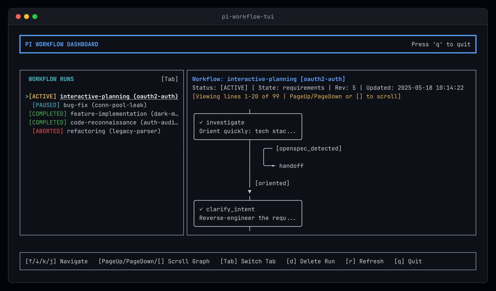

# Workflow Executor for Pi

A transactional state-machine engine, declarative workflow runner, and interactive dashboard for the [Pi coding agent](https://pi.dev).

Workflow Executor coordinates multi-step development processes with an authoritative SQLite state store (`.workflow/state.db`), deterministic state transitions with optimistic locking, interactive human approval gates, loop thrash guards, and automatic Markdown audit logs.

## Features

- **Deterministic State Machines**: Define workflows in declarative YAML with explicit goals, artifacts, entry gates, and exit criteria.
- **Authoritative SQLite State Store**: Persist run states, visit logs, loop counters, and approval records in `.workflow/state.db`.
- **Optimistic Concurrency Control**: Guard transitions against race conditions and out-of-order execution using incremental revision checks (`expectedRevision`).
- **Interactive Human Approval Gates**: Pause runs at sensitive transitions to approve, reject, or discuss steps in chat.
- **Herdr Multiplexer Integration**: Dispatch non-blocking desktop notifications and manage `herdr:blocked` status lifecycle hooks when running inside Herdr (`HERDR_ENV=1`).
- **Loop Thrash Guards**: Halt execution automatically when repetitive transition cycles exceed configurable retry limits.
- **Terminal UI Dashboard**: Inspect runs, browse workflow templates, visualize ASCII/Unicode state graphs, and safely delete completed runs via `pi-workflow-tui`.
- **Automatic Audit Journals**: Render chronological Markdown logs at `.workflow/runs/<workflow>/<task>/workflow-log.md`.
- **Flexible Invocation**: Start workflows through conversational natural language queries or explicit `/workflow` slash commands.
- **Sub-Workflow and Subagent Support**: Compose workflows hierarchically or delegate scoped tasks to named subagents (`scout`, `worker`, `reviewer`).

## Prerequisites

- Node.js >= 22.5.0 (requires native `node:sqlite` and `--experimental-strip-types`)
- pnpm >= 9 (or npm / corepack)
- [Pi coding agent](https://pi.dev)

## Installation

Install the extension directly into Pi from git:

```bash
pi install git:github.com/gierdo/pi-workflow-executor
```

Or install from a local repository clone:

```bash
pi install ./path/to/pi-workflow-executor
```

Pi automatically detects the extension entry point (`./index.ts`) and loads bundled workflows.

### Installing the TUI Executable

To access the `pi-workflow-tui` command globally in your terminal:

```bash
# Link globally via pnpm (recommended)
pnpm link --global

# Or link globally via npm
npm link

# Or symlink directly to ~/.local/bin
mkdir -p ~/.local/bin
ln -sf "$(pwd)/bin/tui.ts" ~/.local/bin/pi-workflow-tui
```

Ensure `~/.local/bin` is present in your shell `PATH`.

## Quickstart

Get up and running with a workflow in under two minutes:

1. Open your target project repository:

   ```bash
   cd /path/to/project
   ```

2. Start a workflow using a natural language query or the `/workflow` slash command in Pi:

   - **Via natural language query:**
     ```text
     Start the interactive-planning workflow for oauth2 authentication
     ```
   - **Via slash command:**
     ```text
     /workflow interactive-planning design oauth2 authentication
     ```

3. Confirm or customize the proposed task slug (interactive dialog for slash commands, or inferred from prompt).
4. Let the agent execute each state. When prompted at approval gates, select **Approve**, **Reject**, or **Chat about it**.
5. Inspect the execution graph and run history at any time:

   ```bash
   pi-workflow-tui
   ```

## Usage

You can start workflows either conversationally through natural language queries or directly via the `/workflow` slash command.

### Natural Language Queries

You do not need to memorize slash commands. You can start or resume any workflow by asking Pi in plain language:

```text
"Fix the connection pool leak using the bug-fix workflow"
"Start interactive-planning to design OAuth2 authentication"
"Run merge-review on the active branch"
"Implement the auth middleware tests using task-implementation"
```

Pi detects the workflow intent and invokes the `workflow_start` tool autonomously. The agent resolves the workflow definition, derives the task slug, records the run in `.workflow/state.db`, and advances through the state machine.

### Slash Command (`/workflow`)

#### Starting a Workflow

Run `/workflow` followed by the workflow identifier and your instructions in natural language:

```text
/workflow <name> [prompt...]
```

Examples:

```text
/workflow interactive-planning design oauth2 authentication with refresh tokens
/workflow bug-fix fix connection timeout in postgres pool
/workflow task-implementation implement auth middleware tests
```

- `<name>`: The identifier of the workflow (e.g. `interactive-planning`, `bug-fix`, or a custom workflow).
- `[prompt...]`: Natural language instructions for the run. The extension normalizes your prompt into a kebab-case task slug and prompts you to confirm or edit it.

To bypass the confirmation dialog and supply a specific task slug upfront, pass the `--slug` flag:

```text
/workflow interactive-planning --slug oauth2-auth design oauth2 authentication
```

#### Inspecting and Resuming Runs

Run `/workflow` without arguments (or `/workflow list`) to launch the interactive run selector:

```text
/workflow
```

The selector displays existing runs and their statuses:

```text
Select a workflow run to inspect or resume:
- [ACTIVE] interactive-planning (oauth2-auth) - state: explore_approaches, rev: 5
- [PAUSED] bug-fix (conn-pool-leak) - state: verify, rev: 3 - waiting for approval
- [COMPLETED] feature-implementation (dark-mode) - state: done, rev: 7
```

Selecting an active or paused run resumes execution immediately. Selecting a completed or aborted run displays its final state and the path to its Markdown journal.

### Agent Tools

In addition to user-initiated slash commands, agents interact with the state engine autonomously via three registered tools.

#### 1. `workflow_start`

Starts a new workflow run or resumes an existing run:

```json
{
  "workflow": "feature-implementation",
  "task": "prompted-workflow-execution",
  "prompt": "Implement ability to start workflows from prompts"
}
```

- `workflow` (string, required): Workflow definition name.
- `task` (string, optional): Kebab-case task slug. Defaults to `main` if omitted.
- `prompt` (string, optional): Context and instructions for the workflow run.

The tool initializes or resumes the run in `.workflow/state.db`, syncs the Markdown journal, and returns execution instructions directly to the agent.

#### 2. `workflow_transition`

Submits a state outcome to advance the workflow state machine:

```json
{
  "runId": "feature-implementation-prompted-workflow-execution",
  "outcomeId": "proposal_accepted",
  "expectedRevision": 3,
  "evidence": [
    "openspec/changes/prompted-workflow-execution/proposal.md created",
    "pnpm test passed with zero errors"
  ]
}
```

- `runId` (string, required): Active run identifier (`<workflow>-<task>`).
- `outcomeId` (string, required): Transition outcome token declared in the active state.
- `expectedRevision` (integer, required): Current revision of the run. Prevents stale or concurrent mutations.
- `evidence` (string[], optional): File paths or test results proving exit criteria.

#### 3. `workflow_list`

Lists workflow runs stored in the local SQLite database:

```json
{
  "status": "active"
}
```

- `status` (string, optional): Filter runs by status (`active`, `paused`, `completed`, or `aborted`). Omit to list all runs.

### Interactive Approval Gates

Transitions with `requires_approval: true` pause automatically and prompt you for sign-off:

```text
Workflow 'interactive-planning' (oauth2-auth) requires approval to transition to 'task_breakdown'.
Reason: plan approved; break it into worker-ready tasks

1. Approve transition to 'task_breakdown'
2. Reject transition
3. Chat about it (ask question or discuss)
```

- **Approve**: Commits the transition and advances to the target state.
- **Reject**: Records the rejection in SQLite and leaves the workflow paused in the current state.
- **Chat about it**: Opens an interactive input prompt for questions or feedback. The agent responds in chat and re-presents the approval dialog.

When running inside a Herdr workspace (`HERDR_ENV=1`), approval gates emit `herdr:blocked` status events and send non-blocking desktop notifications.

---

## Workflow Management TUI

`pi-workflow-tui` provides a terminal dashboard to inspect runs, browse workflow definitions, visualize state machines with ASCII/Unicode graphs, and manage run records.



### Launching the Dashboard

Run the binary directly if linked into your `PATH`:

```bash
pi-workflow-tui
```

Or execute it via repository scripts or npx:

```bash
pnpm tui
# or
npx pi-workflow-tui
```

### Dashboard Features

- **Split-Pane Layout**: The left sidebar lists recorded workflow runs or defined workflow templates. The right pane renders a dynamic ASCII/Unicode graph with box-and-arrow topology (`╭───╮`, `│   │`, `╰───╯`, `──►`).
- **Live State Highlighting**: Visited states are flagged with `✓`, and the current state is marked with `► [CURRENT]`.
- **Template Browser**: Press `Tab` to switch between active runs and static workflow templates (project-local, user-global, or bundled).
- **Safe Run Deletion**: Select any `[COMPLETED]` or `[ABORTED]` run and press `d` to open the confirmation modal. Press `y` to confirm deletion.

### Keyboard Shortcuts

| Key | Action |
| --- | --- |
| `Up` / `Down` or `k` / `j` | Navigate items in the list |
| `PageUp` / `PageDown` or `[` / `]` | Scroll graph view vertically |
| `Tab` | Toggle between Workflow Runs and Workflow Templates |
| `d` | Delete selected completed or aborted run |
| `y` / `n` | Confirm (`y`) or cancel (`n`) run deletion in modal |
| `Esc` | Cancel deletion modal or dismiss status notices |
| `r` | Refresh runs and workflow definitions from disk and database |
| `q` | Exit the dashboard and restore normal terminal screen |

### Deletion Safety Invariants

- **Active and Paused Runs Protected**: Runs currently in `active` or `paused` state cannot be deleted. You must complete or abort a run before deleting it.
- **Transactional Foreign Key Cascade**: Run deletion executes inside an immediate SQLite transaction, cleaning up all child records (`external_actions`, `loop_counts`, `invocations`, `pending_approvals`, `transitions`, `state_visits`, and `runs`) and removing `.workflow/runs/<workflow>/<task>` from disk.

---

## Shipped Workflows

The package bundles 8 standard workflows:

| Workflow | Initial State | Description |
| --- | --- | --- |
| `bug-fix` | `debug` | Drives a bug from report to verified fix. Uses the debug sub-workflow to establish root cause, then plans, implements, and verifies the fix. |
| `code-reconnaissance` | `orient` | Performs read-only codebase reconnaissance, mapping structure, conventions, and dependencies grounded in code actually read. |
| `debug` | `triage` | Triages, reproduces, and diagnoses a bug to establish proven root cause without applying speculative fixes. |
| `feature-implementation` | `orientation` | Guides features through exploration, proposal, implementation loops, verification, review, and archival. |
| `interactive-planning` | `investigate` | Formulates plans interactively through requirements clarification, approach exploration, design validation, and task breakdowns. |
| `merge-review` | `scope` | Conducts thorough pre-merge reviews assessing code against intent, project standards, security, and test coverage. |
| `refactoring` | `goal` | Refactors code while preserving behavioral invariance through baseline verification and incremental verified transformations. |
| `task-implementation` | `intake` | Implements a single pre-planned task from a plan artifact within bounded scope, without re-planning. |

---

## Configuration

### Resolution Hierarchy

When resolving a workflow by name, the extension evaluates sources in strict precedence order. The first match wins:

1. `<cwd>/.workflow/workflows/<name>/<name>.yaml` (project-local)
2. `<cwd>/.pi/workflows/<name>/<name>.yaml` (project-local)
3. `~/.pi/agent/workflows/<name>/<name>.yaml` (user-global)
4. `~/.pi/agent/skills/workflow-executor/workflows/<name>/<name>.yaml` (user-global)
5. Package bundled workflows (fallback)

### Disabling Bundled Workflows

You can disable bundled workflows globally or per-project.

#### Global Configuration

Add configuration to `~/.pi/agent/extensions/workflow-executor/config.json`:

```json
{
  "disableBundled": true
}
```

Or disable specific workflows globally:

```json
{
  "disabledWorkflows": ["bug-fix", "debug"]
}
```

You can also disable bundled workflows via environment variable:

```bash
export PI_WORKFLOW_DISABLE_BUNDLED=1
```

#### Project-Level Configuration

Add configuration to `.workflow/config.json` in your repository:

```json
{
  "disableBundled": true,
  "disabledWorkflows": ["refactoring"]
}
```

---

## Authoring Custom Workflows

Custom workflows are declarative state machines defined in YAML. Store them in:

- Project-local: `.workflow/workflows/<name>/<name>.yaml`
- User-global: `~/.pi/agent/workflows/<name>/<name>.yaml`

### Minimal Example: `deploy-check.yaml`

```yaml
name: deploy-check
version: 1
description: Verify deployment readiness and tag release.

inputs:
  task:
    description: Release or task identifier.
    required: true

initial: check_readiness

states:
  check_readiness:
    goal: Run linters, test suite, and check git status.
    exit_gate: Build passes and git working tree is clean.
    transitions:
      - outcome: tests_failed
        when: Build or tests fail
        to: blocked
        reason: Verification checks failed
      - outcome: ready
        when: exit_gate holds
        to: confirm_deploy
        reason: Readiness verified

  confirm_deploy:
    goal: Request human sign-off before tagging.
    exit_gate: User approves release.
    transitions:
      - outcome: approved
        when: User approves
        to: done
        reason: Sign-off granted
        requires_approval: true

  blocked:
    terminal: true
    goal: Workflow stopped due to verification failures.

  done:
    terminal: true
    goal: Release verified and approved.
```

### Schema Specification

#### Workflow Root

| Field | Type | Required | Description |
| --- | --- | --- | --- |
| `name` | string | Yes | Kebab-case identifier matching the directory name (`^[a-z0-9][a-z0-9-]*$`). |
| `version` | int / string | No | Workflow schema or definition version. |
| `description` | string | No | Summary of intent, scope, and invariants. |
| `inputs` | map | No | Input parameter definitions. `task` is always required. |
| `artifacts` | map | No | Output and intermediate files keyed by identifier. |
| `initial` | string | Yes | Identifier of the starting state (must match a key in `states`). |
| `states` | map | Yes | State definitions keyed by state identifier. |
| `herdr` | map | No | Advisory multiplexer layout hints (`suggested_panes`). |

#### State Definition

| Field | Type | Required | Description |
| --- | --- | --- | --- |
| `goal` | string | No | Goal and scope boundary for the state. |
| `consumes` | string[] | No | Artifact identifiers read during this state. |
| `produces` | string[] | No | Artifact identifiers written during this state. |
| `exit_gate` | string | No | Conditions that must hold before advancing. |
| `terminal` | boolean | No | When `true`, marks the end of a run. Must not define transitions. |
| `invoke` | object | No | Child workflow invocation: `{ workflow: string, inputs?: map, entry?: string }`. |
| `subagent` | string / object | No | Named subagent (`reviewer`, `worker`, `scout`) or `{ agent: string, skills?: string, task?: string }`. |
| `transitions` | object[] | Yes* | Outgoing transition rules (*required for all non-terminal states). |

#### Transition Definition

| Field | Type | Required | Description |
| --- | --- | --- | --- |
| `outcome` | string | Yes | Unique token identifying this branch (passed to `workflow_transition`). |
| `when` | string | No | Condition or trigger for this transition. |
| `to` | string | Yes | Target state identifier (must exist in `states`). |
| `reason` | string | No | Rationale recorded in SQLite and projected to audit logs. |
| `requires_approval` | boolean | No | When `true`, pauses the run and prompts for interactive user sign-off. |
| `max_retries` | integer | No | Maximum loop iterations before the thrash guard halts execution. |

### Hierarchical Sub-Workflows (`invoke:`)

A state can invoke another workflow as a child unit:

```yaml
states:
  run_diagnosis:
    invoke:
      workflow: debug
      inputs: { require_openspec: true }
      entry: diagnose
    transitions:
      - outcome: debug_completed
        when: Child ended in done
        to: plan_fix
      - outcome: debug_aborted
        when: Child ended in abort
        to: abort
```

Child workflows execute with their own run record in SQLite and their own Markdown log. When the child terminates, the parent evaluates the child outcome and follows the matching transition.

### Subagent Delegation (`subagent:`)

States declaring `subagent:` delegate execution to a specialized agent:

```yaml
states:
  audit_code:
    goal: Review pull request diff for security and architectural regressions.
    subagent:
      agent: reviewer
      skills: software-engineering
    transitions:
      - outcome: review_passed
        to: merge
      - outcome: changes_requested
        to: rework
```

The orchestrator:

1. Dispatches the subagent with its active state, goal, inputs, and artifact paths.
2. Evaluates returned work against the state `exit_gate`.
3. Commits the transition via `workflow_transition`. Subagents never commit state transitions directly.

---

## Contributing

### Prerequisites

- Node.js >= 22.5.0
- pnpm >= 9

### Development Setup

1. Clone the repository:

   ```bash
   git clone https://github.com/gierdo/pi-workflow-executor.git
   cd pi-workflow-executor
   ```

2. Install dependencies:

   ```bash
   pnpm install
   ```

3. Run the test suite:

   ```bash
   pnpm test
   ```

### Test Architecture

Tests run using Node's built-in test runner (`node:test` and `node:assert/strict`) with native TypeScript type stripping (`--experimental-strip-types`). No build step or transpilation is required.
